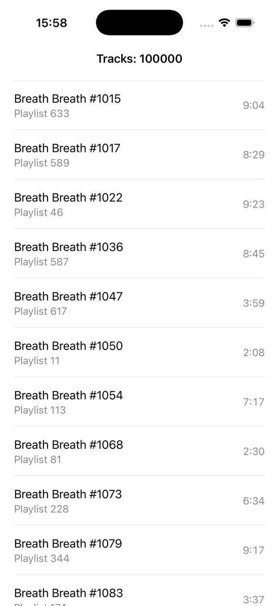

# TestPlaylistsApp

Test task: two Core Data models with a relationship, a generator of 100 000 random objects, a background fetch, and a table built with UIKit and Auto Layout in code.

<p>
  
  
</p>

## How to run

1. Open `TestPlaylistsApp.xcodeproj` in Xcode.
2. Select an iOS Simulator and press **Run** (⌘R).

There are no third-party dependencies. On the first launch the app generates the data, so the loading indicator shows for a few seconds. Later launches reuse the existing database.

## Task checklist

| Requirement | Implementation |
|---|---|
| Model A has a to-many relationship to model B, and B has an inverse relationship to A | `Playlist.tracks` (to-many) and `Track.playlist` (to-one), set as inverse of each other |
| Generator of 100 000 objects with random values | `Generator` creates 1 000 playlists × 100 tracks with random titles and durations |
| Fetch in background, pass to the main thread, show title/id in a table | `TracksRepository` fetches in a background context and delivers `[TrackItem]` on the main queue |
| UIKit and Auto Layout, no Storyboard | UI is built in code with native layout anchors; storyboards are removed |

## Project structure

```
TestPlaylistsApp/
├── App/              AppDelegate, SceneDelegate (window created in code)
├── CoreData/         Model.xcdatamodeld, CoreDataStack
├── Models/           TrackItem
├── Services/         Generator, TracksRepository
├── Screens/Tracks/   TracksViewController, TrackCell
└── Resources/        Assets, Info.plist
```

## Implementation details

### Data model
- **Playlist:** `id: UUID`, `title: String`, `tracks` → Track (to-many, delete rule **Cascade**).
- **Track:** `id: UUID`, `title: String`, `duration: Double`, `playlist` → Playlist (to-one, delete rule **Nullify**).

The relationships are inverse of each other, so Core Data keeps both sides in sync. Setting `track.playlist` adds the track to `playlist.tracks`.

### Core Data stack
`CoreDataStack` owns a single `NSPersistentContainer` with a SQLite store. `viewContext` has `automaticallyMergesChangesFromParent` enabled, so it sees changes saved by background contexts.

### Generator
- Runs in a background context via `performBackgroundTask`, so the UI is not blocked.
- Saves in batches of 5 000 tracks and calls `reset()` after each save to keep memory usage low.
- Checks `count(for:)` first and skips generation if data already exists.
- Reports the result on the main queue as `Result<Void, Error>`.

### Background fetch
- `TracksRepository` fetches tracks sorted by `title` in a background context.
- Prefetches the `playlist` relationship to avoid a separate fault for each row.
- `NSManagedObject` instances are bound to their context's queue, so they are not passed to the main thread. Instead, they are mapped to a plain `TrackItem` struct in the background, and the array is delivered on the main queue.

### UI
- `TracksViewController` shows an activity indicator, runs generation, then the fetch, and calls `reloadData()`. Errors are shown in an alert.
- `TrackCell` is a custom cell with the title, playlist name and duration (monospaced digits). Its height comes from Auto Layout constraints.
- Cells are reused via `dequeueReusableCell(withIdentifier:for:)`, so 100 000 rows scroll smoothly.
- Classes receive `NSPersistentContainer` through `init` with a default value, so a different container (for example, an in-memory one for tests) can be injected.

## Performance

Measured on iPhone 17 Pro Simulator:

| Operation | Time |
|---|---|
| Generate 100 000 tracks (first launch) | ~2.5 s |
| Fetch and map 100 000 tracks | ~0.4 s |
